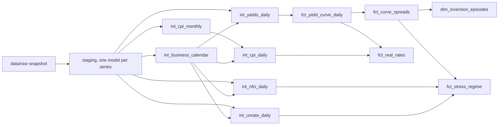
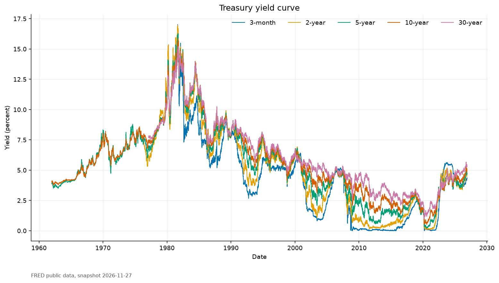
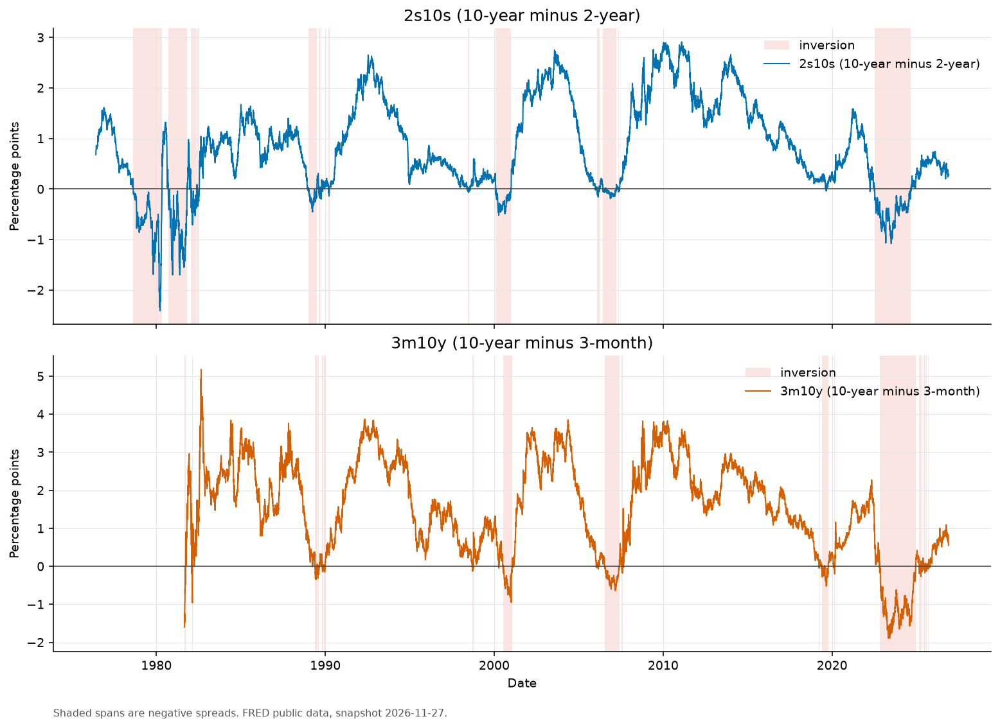
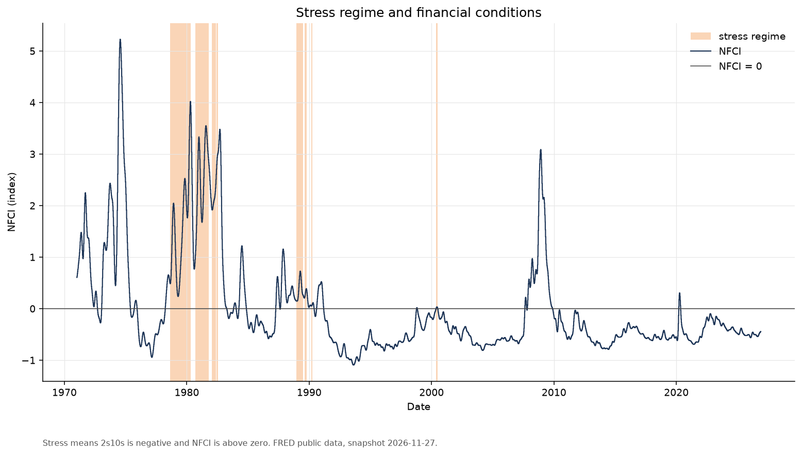
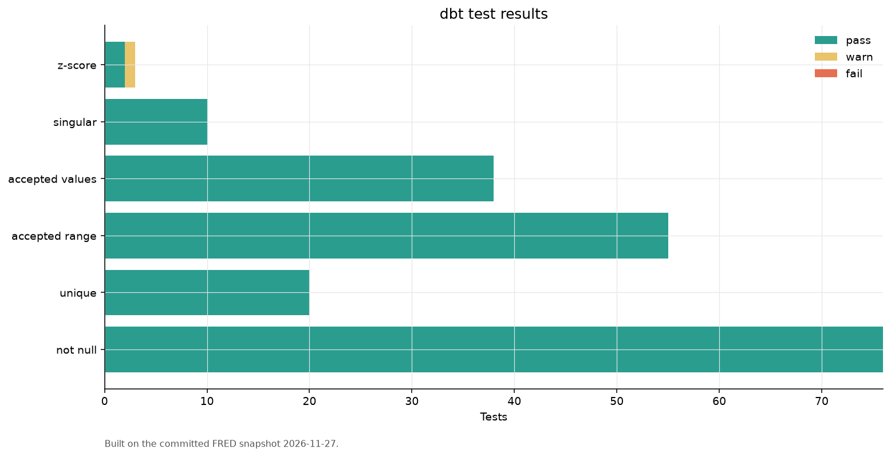

# macro-rates-data-mart

Can a risk team trust a daily macro and rates feed?

This project answers that with a small, offline, tested mart. Public FRED series are frozen into a dated snapshot, typed in dbt, and checked before they reach five marts. The build below is the snapshot retrieved on 2026-11-27. Every number in this file comes from that build.

On the latest business day in the mart, **2026-11-24**, the curve is not inverted and the stress rule is off:

| Tenor or spread | Value |
| --- | ---: |
| 3-month | 4.36% |
| 2-year | 4.63% |
| 5-year | 4.69% |
| 10-year | 4.91% |
| 30-year | 5.30% |
| Effective fed funds | 3.88% |
| 2s10s | +0.28 percentage points |
| 3m10y | +0.55 percentage points |
| NFCI | -0.444 |
| Unemployment | 4.1% |
| Stress regime | false |

The 10-year real yield is null on that date. CPI for October 2025 is the only missing month in `CPIAUCSL`, so the October 2026 year-over-year change has no base and the real-rate columns stay null while that print is the one in force. The last business day with a 10-year real yield is **2026-09-30**: a 5.29% nominal 10-year yield, 3.72% year-over-year CPI, and a real 10-year yield of 1.57%.

The daily Treasury spine is the part a risk team can lean on. The panel runs from 1962-01-02 through 2026-11-24 and has 16,209 business days with no gaps. The 10-year yield is the original print on every one of those days (`yield_10y_carried_days` is 0). After the 30-year series starts on 1977-02-15, every later business day has a 30-year yield. Spreads equal the difference of their legs. The monthly CPI and unemployment series are a different object: they are step-filled onto business days, and a missing index month blocks the real-rate calculation until a 12-month base exists again.

## Run

From the repository root, with Python 3.12:

```bash
pip install -r requirements.txt
dbt build --profiles-dir .
python -m macro_rates.export_docs
```

`dbt build` creates `data/macro_rates.duckdb` from the committed snapshot and runs the tests. The export writes mart CSVs under `data/exports/` and refreshes the charts and `docs/highlights.json`.

To refresh the snapshot from the public fredgraph CSV endpoint:

```bash
python -m macro_rates.snapshot --snapshot-date 2026-11-27
```

Point `snapshot_date` in `dbt_project.yml` at the new folder. The committed snapshot is what CI builds. No API key is required, and no Moody's or ICE series are used.

## Architecture



Staging casts each FRED file to `observation_date` and `measure_value`, one model per series: `DGS3MO`, `DGS2`, `DGS5`, `DGS10`, `DGS30`, `DFF`, `CPIAUCSL`, `UNRATE`, and `NFCI`.

The business calendar is weekdays minus the Treasury full-close set: New Year's Day (Monday when it falls on Sunday; a Saturday does not close the prior Friday), MLK Day from 1986, Washington's Birthday, Lincoln's Birthday through 1985, Good Friday except years the file still has a yield, Memorial Day, Juneteenth from 2022, Independence Day, Labor Day, Columbus Day, Election Day through 1984, Veterans Day, Thanksgiving, and Christmas, plus a short list of extraordinary closes in `seeds/us_market_extra_closures.csv`. Equity holidays are not this set. Columbus Day and Veterans Day are closes here. Good Friday 2026 has a print, so it stays on the spine.

Forward fill is last observation carried forward, never backward:

| Series | Native frequency | Maximum carry |
| --- | --- | --- |
| Treasury yields and fed funds | business day | 5 business days |
| NFCI | weekly | 10 business days |
| CPI and unemployment | monthly | 45 business days |

A gap longer than the cap becomes null. CPI year-over-year is the percent change versus the same month one year earlier, computed on the monthly index before the step onto business days. Real yields are that nominal percent minus that CPI percent. They are not TIPS and they are not a point-in-time vintage: the monthly value is known for the whole month in this mart, including days before the index was published.

`fct_curve_spreads` defines `spread_2s10s` as the 10-year yield minus the 2-year yield, and `spread_3m10y` as the 10-year yield minus the 3-month yield. A spread is inverted only when it is strictly negative.

`dim_inversion_episodes` is one row per uninterrupted negative run. In this build:

| Spread | Episodes | Open | Shortest | Median | At least 60 business days | Longest |
| --- | ---: | ---: | ---: | ---: | ---: | --- |
| 2s10s | 44 | 0 | 1 business day | 3.5 business days | 7 | 2022-07-06 to 2024-08-26, 537 business days, 783 calendar days, depth 108 bps on 2023-07-03 |
| 3m10y | 55 | 0 | 1 business day | 3.0 business days | 3 | 2022-10-25 to 2024-12-12, 534 business days, 780 calendar days, depth 189 bps on 2023-06-01 |

Most spells are a few days. The long 2022-2024 inversion is closed. None of its 537 business days is a stress day.

`fct_stress_regime` is true only when `spread_2s10s` is negative and NFCI is strictly above zero. The column `rule_code` is `2s10s_negative_and_nfci_positive` on every row. If either input is null, `stress_regime` is null rather than false. Unemployment is carried on the same row and is not an input. This build has 1,042 stress days in 21 episodes, 11,575 days with the flag off, and 3,592 days with the flag null. The 2008 NFCI spike is not shaded as stress: financial conditions were tight and the 2s10s spread was not negative.

## Charts









## Data quality

`dbt build` on this snapshot runs 202 data tests: 201 pass and 1 warning. The warning is the rolling z-score on NFCI. It uses the prior 252 observations, excludes the current point from its own mean and deviation, and warns above 8. The only row over that line is 2020-03-06. The build does not fail on a warning.

Generic tests cover `not_null`, `unique`, `accepted_values`, and `accepted_range`. Singular tests check that the curve has every business day and no extra dates, that weekday Treasury prints sit on the calendar, that each spread equals its two legs, that each real yield equals nominal minus CPI year-over-year, that the stress flag matches the documented rule, that inversion episodes tile the negative days, and that a filled yield equals the source print on its as-of date. Mart contracts enforce column names and types. The z-score test is `tests/generic/zscore_anomaly.sql`.

Source freshness is configured and is not part of the three commands above, because CI rebuilds a frozen file. `dbt source freshness` compares the latest observation, cast to a timestamp, with the warehouse clock. Daily series warn after 7 days and error after 14. NFCI warns after 14 and errors after 28. CPI and unemployment warn after 50 and error after 80. On this snapshot the daily and weekly sources pass. CPI and unemployment warn, which matches a latest monthly print of 2026-10-01.

The snapshot manifest at `data/raw/2026-11-27/manifest.json` records the fredgraph URL for each series, the window URLs used to download it, the retrieval timestamp, row counts, null counts, the date span, and a SHA-256 of the file. Pytest checks the manifest against the CSVs.

## Snowflake

The project runs on DuckDB. `profiles.snowflake.example.yml` is the same profile name with environment variables only:

```yaml
macro_rates:
  target: snowflake
  outputs:
    snowflake:
      type: snowflake
      account: "{{ env_var('SNOWFLAKE_ACCOUNT') }}"
      user: "{{ env_var('SNOWFLAKE_USER') }}"
      password: "{{ env_var('SNOWFLAKE_PASSWORD') }}"
      role: "{{ env_var('SNOWFLAKE_ROLE') }}"
      database: "{{ env_var('SNOWFLAKE_DATABASE') }}"
      warehouse: "{{ env_var('SNOWFLAKE_WAREHOUSE') }}"
      schema: "{{ env_var('SNOWFLAKE_SCHEMA') }}"
      threads: 8
```

To use it, install `dbt-snowflake` at the same dbt-core 1.11 minor version, load the snapshot CSVs into a raw schema, and replace the `read_csv_auto` source locations with those tables. The business-day spine in `int_business_calendar` uses DuckDB `generate_series`; point that model at a date dimension instead. The forward fill itself is `max` over a window ordered by date, which Snowflake can run. Set `DBT_PROFILES_DIR` to the example file's directory and select the `snowflake` target. Do not put credentials in the repository.

## Layout

```text
src/macro_rates/     download, calendar, charts, export
models/staging/      one typed model per FRED series
models/intermediate/ calendar, forward fill, monthly CPI change
models/marts/        contracted facts and the inversion dimension
tests/               singular tests and generic accepted_range and z-score tests
seeds/               Treasury close calendar
data/raw/            committed snapshot and manifest
docs/                charts and highlights.json
```

## License

MIT. See [LICENSE](LICENSE).
